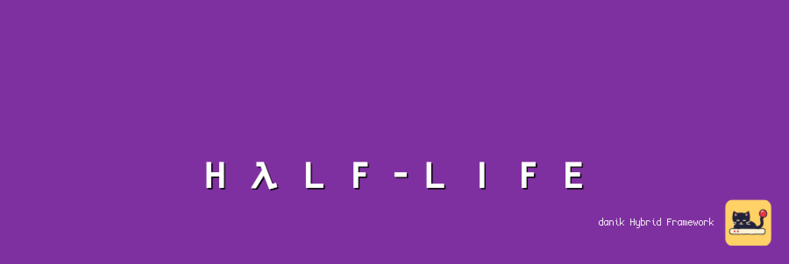
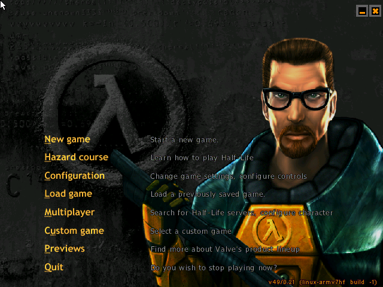

# Xash3D for MiSTer

Half-Life and its expansions Opposing Force and Blue Shift on [MiSTer FPGA](https://github.com/MiSTer-devel/Main_MiSTer/wiki) as a hybrid port.

The game is [Xash3D FWGS](https://github.com/FWGS/xash3d-fwgs), the FWGS team's continuation of Uncle Mike's Xash3D, an engine compatible with Valve's GoldSrc, with its software renderer, and the games' code from [hlsdk-portable](https://github.com/FWGS/hlsdk-portable), the FWGS port of Valve's Half-Life SDK (and of Opposing Force and Blue Shift). It runs on the MiSTer's ARM CPU. The Xash3D FPGA core provides native 15kHz video (CRT, VGA and HDMI) at 320x200 or 320x240 in the game and 640x480 in the menus, 44.1kHz audio and keyboard, mouse and gamepad input. The two halves talk through shared DDR3 memory.

> **Beta.** Expect rough edges and please report problems in the issues.
>
> **Disclaimer:** AI is being extensively used to speed up development, but the project is well-maintained and supported.

  
  

## Requirements

- **danik_hybrid_ports**, the launcher: run it **once** from the MiSTer's `Scripts` menu ([The launcher](#the-launcher)). Without it the core says "Game not running".
- **Game data**, which is not included: the folder `valve` of Half-Life, from Steam or the CD (not *Half-Life: Source*). For the expansions, also their folder: `gearbox` (Opposing Force) or `bshift` (Blue Shift), from Steam or their CDs.
- **Recommended:** a gamepad with two analog sticks and analog triggers, like an Xbox or PlayStation controller. A gamepad without them works but is not recommended. The game can also be played with a keyboard and mouse.

## Installation

With `update_all` (Downloader 2.4 or newer, which update_all keeps up to date):

1. Copy [`downloader_danik_hybrid_ports.ini`](https://raw.githubusercontent.com/ItsDanik/Hybrid_MiSTer/main/launcher/downloader_danik_hybrid_ports.ini) to the root of your SD card (`/media/fat`).
2. Run `update_all`. That installs the launcher, **danik_hybrid_ports**, in `Scripts`.
3. Run **danik_hybrid_ports** from the `Scripts` menu, tick the games you want and press *X: Apply*. They are installed, and update_all keeps them up to date.
4. Copy each game's **whole folder**, with everything in it, to `/media/fat/games/dnk/Xash3D/`, over the folders that are there (they only hold our code for each game, `cl_dlls/client_armv7hf.so` and `dlls/*_armv7hf.so`, names no game file has). Each game is known by its folder:

   | Game | Folder |
   |---|---|
   | Half-Life | `valve` (with `liblist.gam`, `halflife.wad`, `maps`, `sound` and the rest) |
   | HL: Opposing Force | `gearbox`, next to `valve` |
   | HL: Blue Shift | `bshift`, next to `valve` |
5. Load the game from the `Other` menu, e.g. **dnk-Half-Life**, or from the `Hybrid Ports` folder if you moved the games there in the launcher.

> [!NOTE]
> The game data can go on a USB drive instead, into the same folder there (`/media/usb0/games/dnk/Xash3D/`, with `valve` and the expansions' folders in it): the game looks for it there first, and then keeps its settings and saved games there as well. Everything else stays on the SD card, the games' code in its `valve`, `gearbox` and `bshift` folders too.

Opposing Force and Blue Shift need Half-Life's folder `valve` as well. When a game's files are missing, the core says which files to copy where. Each game keeps its own OSD settings and button mappings. The core file itself (`_Other/dnk/dnk-Xash3D_*.rbf`, or from *Recent*) lists the games that are there to pick from; quitting a game then returns to the list. The game's log is in `/media/fat/logs/dnk/Xash3D/xash3d.log`. Each game keeps its settings (`config.cfg`) and saved games (`save/`) in its own folder, e.g. `/media/fat/games/dnk/Xash3D/valve/` (on the USB drive, if the game data is there).

## The launcher

**danik_hybrid_ports** is what turns a menu entry into a running game. Once you've run it from the `Scripts` menu, it starts with the MiSTer, watches which core is loaded, and starts the game whenever a hybrid port's menu entry is loaded. It serves all our hybrid ports at once and updates itself through `update_all`.

Run it from the `Scripts` menu again whenever you want to change something. Its screen has:

- **Launcher**: on or off. Off, the ports' games no longer start (the core says "Game not running"), until you turn it on again.
- **Menu entries**: where the games appear in the MiSTer menu:
  - **Other, as dnk-\<Title\>**: each game in the `Other` menu, e.g. **dnk-Doom** (the default).
  - **Other/Hybrid Ports**: all of them in a *Hybrid Ports* folder in `Other`, without the `dnk-` in front.
  - **Main menu/Hybrid Ports**: a *Hybrid Ports* folder of its own in the main menu, next to `Arcade`, `Console` and `Other`.

  Moving them keeps each game's settings and button mappings. Favourites, recent lists and Zaparoo tags that point at the old place have to be made again.
- **The ports and their games**, a tickbox each. Tick what you want, untick what you don't.

*X: Apply* installs what is ticked and removes what is not, through Downloader, and moves the menu entries if you chose another place. When a port is removed, your game data, saved games and settings stay, and ticking it again brings it back as it was.

## OSD options

| Option | |
|---|---|
| Aspect ratio, Scale, Scandoubler Fx, Stereo Mix | as in other cores |
| FPS Counter | shows the pictures per second in the top left corner |
| HDMI Only | **Yes** if no CRT is connected: resolutions of 640x400 and more are then progressive instead of interlaced, and the analog output is switched off while one is shown, so that a 15kHz screen can never get such a signal. Here that is the menus (640x480); the game itself is not affected. Not needed with `forced_scandoubler=1` (VGA monitor); not there with `direct_video=1` |
| CRT Options | **Horizontal Size**: the picture's width **Horizontal Pos**: moves it left or right **Vertical Pos**: moves it up or down **HUD (Top)**: moves the weapon list and the flashlight 0 to 24 lines down from the top edge (default 0) **HUD (Bottom)**: moves health, armour and ammo 0 to 24 lines up from the bottom edge (default 0)  For a 15kHz screen: fits the picture to it and keeps the HUD out of the overscan. The HUD lines work at 320x240 and move the HUD at once; greyed out at 320x200. HDMI is not affected; not there with `forced_scandoubler=1` |
| Resolution | **320x200**: the game's view in 200 lines (default) **320x240**: the view fills all 240 lines  At 320x240 the HUD is drawn over the view at the *HUD* margins. The menus are always 640x480. Applies at once |
| Lock to 30 FPS | **Off**: up to 60 pictures a second (default) **On**: a picture every second field, an even 30 a second where the game cannot keep up with 60 |
| Rumble | **On**: the gamepad shakes with your shots, the damage you take, explosions near you and screen shakes (default) **Strong**: twice as strong **Off**: no rumble |
| Cheats | **God Mode**: nothing hurts you **No Clip**: fly through walls **Invisible to Monsters**: monsters ignore you **Give All Weapons**: the suit, armour, every weapon and ammo **Long Jump Module**: the long jump module (with the suit only)  God Mode, No Clip and Invisible to Monsters stay on through saved games and level changes until they are turned off |
| Save Diagnostic Report | the last line: see [If something is wrong](#if-something-is-wrong) |

## Controls

- **Keyboard and mouse:**

| Key | Action |
|---|---|
| W, S, A, D (or the arrow keys) | Walk forward, back, sidestep left, right |
| Mouse | Turn and look around |
| Left / right mouse button | Primary / secondary attack |
| Space | Jump |
| Ctrl | Duck |
| Shift | Walk |
| E | Use |
| R | Reload |
| F | Flashlight |
| 1 - 5, mouse wheel | Weapons |
| Q | Last weapon used |
| T | Spray your logo |
| F6, F7 | Quick save, quick load |
| Esc | Menu |

- **Gamepad** (default mapping):

| Button | Action |
|---|---|
| Left stick | move and strafe |
| Right stick | look around |
| Left stick click (L3) | walk / run, toggles |
| Right stick click (R3) | flashlight on / off |
| D-pad left / right | previous / next weapon |
| D-pad up | last weapon used |
| D-pad down | spray your logo |
| A (Xbox B / PlayStation Circle) | jump, swim up |
| B (Xbox A / PlayStation Cross) | duck, swim down |
| X (Xbox Y / PlayStation Triangle) | use |
| Y (Xbox X / PlayStation Square) | reload |
| L (LB / L1), L2 | secondary attack |
| R (RB / R1), R2 | primary attack |
| Select | next weapon |
| Start | menu |

Change the buttons in the OSD under *Define Xash3D buttons*. *Menu OK* and *Menu Back* there are only needed for a spare button without a game function. While the OSD is open, the game gets no input.

> [!WARNING]
> A button left without a name in *Define Xash3D buttons* does not reach the game at all, except L2/R2, L3/R3 and *Menu OK* / *Menu Back*. Name every button there, or leave the definition as it is. To go back to the default buttons, delete `config/inputs/Xash3D_*_input_*_v3.map` (each game has its own) on the SD card.

The game's own menu can change what each gamepad button does: *Configuration*, *Controls*. Change the actions there rather than in the OSD; a button the OSD leaves without a name never reaches the game, so its menu cannot bind it.

## If something is wrong

If the game stutters, the sound breaks up or something else is wrong, open the OSD while it happens and pick **Save Diagnostic Report**, the last line of the menu. The game keeps running; MiSTer's info box says the report is saved in `games/dnk/diagnostics/` on the SD card. Send that file (`Xash3D_<date>_<time>.zip`) with a few words on what went wrong.

The report has the setup (versions, the video and audio lines of `MiSTer.ini`, the OSD settings), how the last 60 seconds went, the game's log and a screenshot. Nothing else: no network settings, addresses, saved games or lists of your files.

## Building

How the port works, how to build it and notes for development: [NOTES.md](NOTES.md).

## Support

If you enjoy this project, you can support my work on [Patreon](https://www.patreon.com/itsdanik).

## Credits

- **[Xash3D FWGS](https://github.com/FWGS/xash3d-fwgs)** by Uncle Mike (Xash3D) and the FWGS team, and **[hlsdk-portable](https://github.com/FWGS/hlsdk-portable)** by the FWGS team, after Valve's Half-Life SDK.
- **Half-Life** by Valve; **Opposing Force** and **Blue Shift** by Gearbox Software.
- **[SDL](https://libsdl.org)** by Sam Lantinga and contributors.
- **[MiSTer](https://github.com/MiSTer-devel)** by Sorgelig and the MiSTer-devel contributors: the framework and Template_MiSTer.
- **[MiSTer Frontier](https://github.com/MiSTerOrganize/MiSTer_Frontier)** by MiSTer Organize: thank you for the inspiration. Hybrid cores on the MiSTer, and the way their game is launched (a daemon that watches the loaded core and runs a script from its games folder), were inspired by MiSTer Frontier.

This project and its maintainers are in no way associated with or endorsed by Valve or Gearbox Software. It does not include any game data.

## License

The top-level scripts, tools and documentation are licensed under the [GPL-3.0](LICENSE). The components keep their own licenses: the part of the shared framework the game is linked with (`hybrid/hps/`) is GPL-2.0-or-later, the rest of `hybrid/` GPL-3.0 except where its files say otherwise, the engine Xash3D FWGS is GPL-3.0, the games' code from hlsdk-portable has Valve's Half-Life SDK license (`LICENSE-hlsdk.txt` in the release), SDL and the SDL drivers in `hybrid/sdl2` are zlib, the FPGA core and the MiSTer framework are GPL-2.0 (`core/LICENSE`, with the core's own sources GPL-2.0-or-later).
