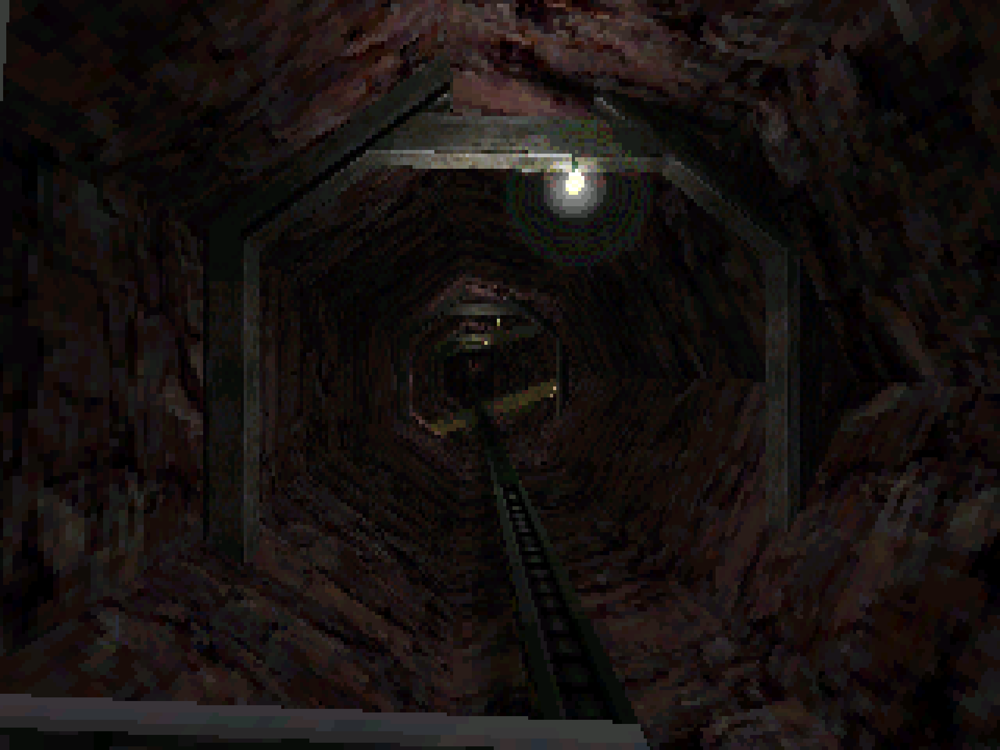
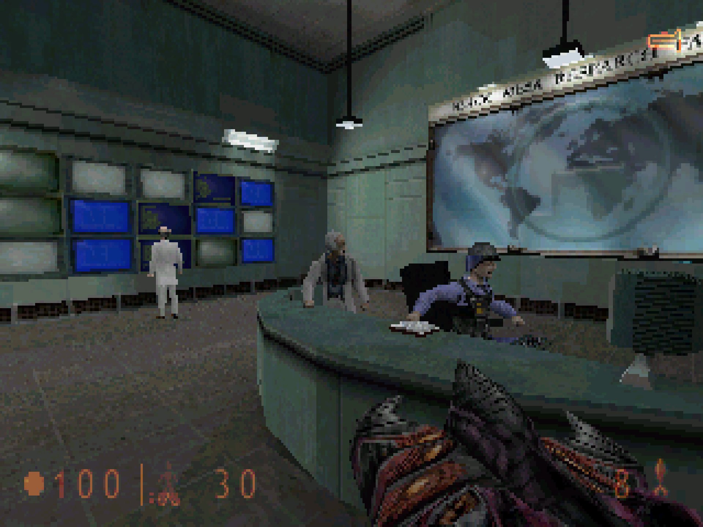
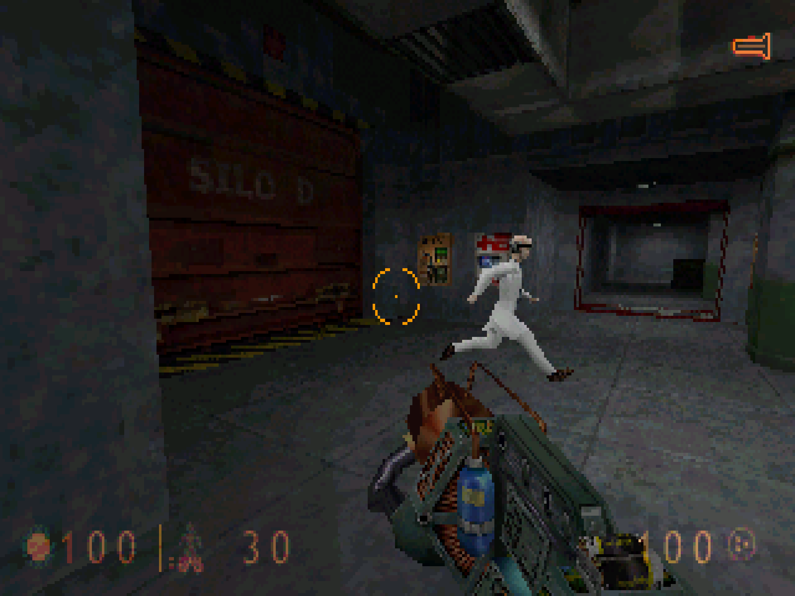
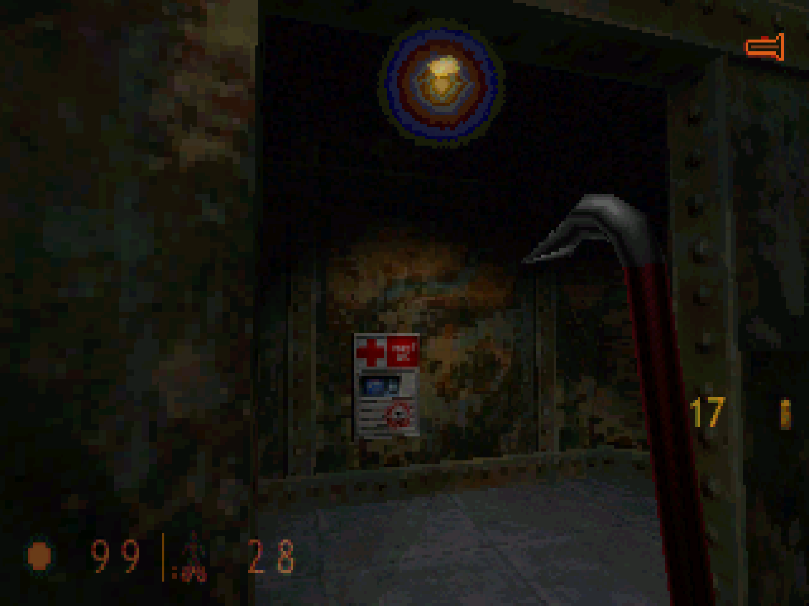
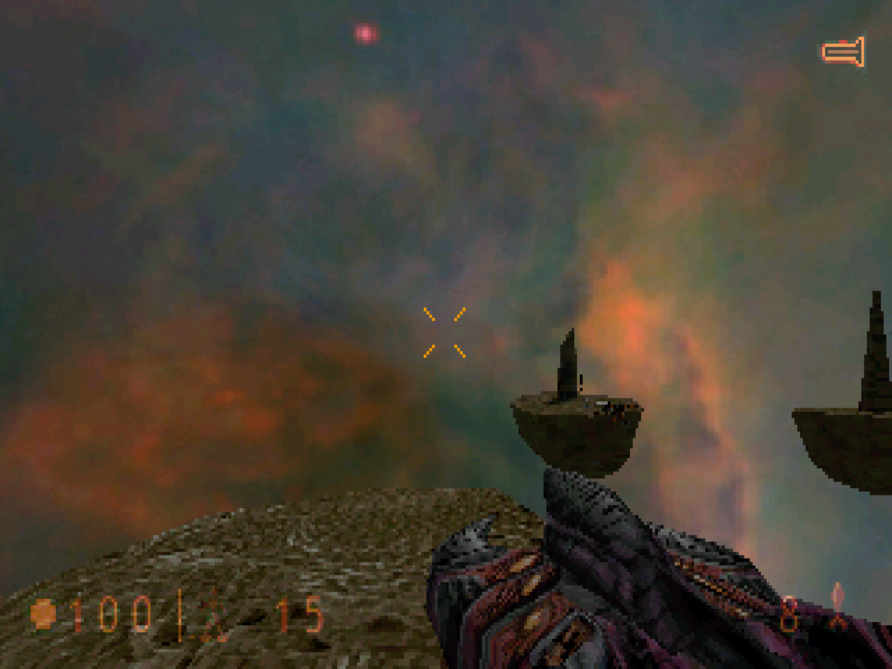

# Xash3D for MiSTer

Half-Life and its expansions Opposing Force and Blue Shift on [MiSTer FPGA](https://github.com/MiSTer-devel/Main_MiSTer/wiki) as a hybrid port.

The game is [Xash3D FWGS](https://github.com/FWGS/xash3d-fwgs), the FWGS team's continuation of Uncle Mike's Xash3D, an engine compatible with Valve's GoldSrc, with its software renderer, and the games' code from [hlsdk-portable](https://github.com/FWGS/hlsdk-portable), the FWGS port of Valve's Half-Life SDK (and of Opposing Force and Blue Shift). It runs on the MiSTer's ARM CPU. The Xash3D FPGA core provides native 15kHz video (CRT, VGA and HDMI) at 320x200 or 320x240 in the game and 640x480 in the menus, 44.1kHz audio and keyboard, mouse and gamepad input. The two halves talk through shared DDR3 memory.

| | |
|---|---|
|  |  |
|  |  |
|  |  |

Taken from the core's output on a MiSTer, as they are on a 4:3 screen.

> **Beta.** Expect rough edges and please report problems in the issues.

Disclaimer: AI is being used to speed up development of this project.

## Requirements

- **danik_hybrid_ports**, the launcher (`Scripts/danik_hybrid_ports.sh`): run it **once** from the MiSTer's `Scripts` menu. It starts the game whenever its menu entry is loaded, keeps running after a reboot, and serves all our hybrid ports; its screen picks which ports and games to have, and can keep them up to date through `update_all`. It replaces `danik_hybrid_cores`, the launcher before it, and moves ports installed the old way (`games/Xash3D/`) into the new folders by itself. Without it the core says "Game not running".
- **Game data**, which is not included: the folder `valve` of Half-Life, from Steam or the CD (not *Half-Life: Source*). For the expansions, also their folder: `gearbox` (Opposing Force) or `bshift` (Blue Shift), from Steam or their CDs.
- **A twin stick gamepad** (two analog sticks, like an Xbox or PlayStation controller): the left stick moves, the right stick looks around, and the d-pad is for weapons.

## Installation

With `update_all` (Downloader 2.4 or newer, which update_all keeps up to date):

1. Copy [`downloader_danik_hybrid_ports.ini`](https://raw.githubusercontent.com/ItsDanik/Hybrid_MiSTer/main/launcher/downloader_danik_hybrid_ports.ini) to the root of your SD card (`/media/fat`).
2. Run `update_all`. That installs the launcher, **danik_hybrid_ports**, in `Scripts`.
3. Run **danik_hybrid_ports** from the `Scripts` menu, tick the games you want and press *X: Apply*. They are installed, and update_all keeps them up to date.

By hand:

1. Download the newest `Xash3D_YYYYMMDD.zip` from [releases](releases/) and extract it to the root of your SD card (`/media/fat`). That gives you:
   - `_Other/dnk-Half-Life.mgl`, `_Other/dnk-HL Opposing Force.mgl` and `_Other/dnk-HL Blue Shift.mgl`, the games' entries in the `Other` menu
   - `_Other/dnk/dnk-Xash3D_YYYYMMDD.rbf`, the FPGA core
   - `games/dnk/Xash3D/`, the engine, the games' code in `valve`, `gearbox` and `bshift`, and the launch script
   - `Scripts/danik_hybrid_ports.sh`, the launcher (from [Hybrid_MiSTer](https://github.com/ItsDanik/Hybrid_MiSTer))
   - `downloader_danik_hybrid_ports.ini`, with which `update_all` keeps the ports up to date from then on
2. Copy the game data to `/media/fat/games/dnk/Xash3D/`, over the folders that are there (they only hold our code for each game, `cl_dlls/client_armv7hf.so` and `dlls/*_armv7hf.so`, names no game file has):
   - `valve`, the whole folder of Half-Life (with `liblist.gam`, `halflife.wad`, `maps`, `sound` and the rest)
   - optional: `gearbox` (Opposing Force) and `bshift` (Blue Shift), the whole folders
3. Run **danik_hybrid_ports** from the `Scripts` menu, if you have not done so before (see Requirements).
4. Load the game from the `Other` menu, e.g. **dnk-Half-Life**.

The game data can go on a USB drive instead, into the same folder there (`/media/usb0/games/dnk/Xash3D/`, with `valve` and the expansions' folders in it): the game looks for it there first, and then keeps its settings and saved games there as well. Everything else stays on the SD card, the games' code in its `valve`, `gearbox` and `bshift` folders too.

Opposing Force and Blue Shift need Half-Life's folder `valve` as well. When a game's files are missing, the core says which files to copy where. Each game keeps its own OSD settings and button mappings. The core file itself (`_Other/dnk/dnk-Xash3D_*.rbf`, or from *Recent*) lists the games that are there to pick from; quitting a game then returns to the list. The game's log is in `/media/fat/logs/dnk/Xash3D/xash3d.log`. Each game keeps its settings (`config.cfg`) and saved games (`save/`) in its own folder, e.g. `/media/fat/games/dnk/Xash3D/valve/` (on the USB drive, if the game data is there).

## OSD options

| Option | |
|---|---|
| Aspect ratio, Scale, Scandoubler Fx, Stereo Mix | as in other cores |
| FPS Counter | shows the pictures per second in the top left corner |
| HDMI Only | **Yes** if no CRT is connected: resolutions of 640x400 and more are then progressive instead of interlaced, and the analog output is switched off while one is shown, so that a 15kHz screen can never get such a signal. Here that is the menus (640x480); the game itself is not affected. Not needed with `forced_scandoubler=1` (VGA monitor); not there with `direct_video=1` |
| CRT Options | for a 15kHz screen: *Horizontal Size*, *Horizontal Pos* and *Vertical Pos* fit the picture to it. The pixels stay as they are; HDMI is not affected. The size is for the game's picture: the core's own, with its messages, keeps its width. Not there with `forced_scandoubler=1`. *HUD (Top)* and *HUD (Bottom)*: at 320x240, how many lines the HUD keeps from the top and bottom edges of the screen, 0 to 24 (10 by default), so that a CRT's overscan does not hide it: the weapon list and the flashlight at the top, health, armour and ammo at the bottom. 0 is the very edge, for HDMI. Greyed out at 320x200 |
| Resolution | the game in **320x200** (default) or 320x240. At 320x240 the view fills all 240 lines, from the top edge to the bottom one, and the HUD is drawn over it at the *HUD* margins. The menus are always 640x480. Applies at once |
| Lock to 30 FPS | **On**: a picture every second field, an even 30 per second where the game cannot keep up with 60. **Off** (default): up to 60 |
| Cheats | *God Mode*, *No Clip* (fly through walls) and *Invisible to Monsters* stay on while they are on, through saved games and level changes, and are gone when turned off. *Give All Weapons* gives the suit, armour, every weapon of the game and ammo for them, once each time it is selected. *Long Jump Module* gives the long jump module (with the suit only, as in the game) |

## Controls

- **Keyboard and mouse:** Half-Life's own keys, from the game's settings (`config.cfg`), which the game's *Configuration*, *Controls* menu changes:

| Key | Action |
|---|---|
| W, S, A, D (or the arrow keys) | Walk forward, back, sidestep left, right |
| Mouse | Turn and look around |
| Left / right mouse button | Primary / secondary attack |
| Space | Jump |
| Ctrl | Duck |
| Shift | Walk |
| E | Use |
| R | Reload |
| F | Flashlight |
| 1 - 5, mouse wheel | Weapons |
| Q | Last weapon used |
| T | Spray your logo |
| F6, F7 | Quick save, quick load |
| Esc | Menu |

- **Gamepad** (default mapping):

| Button | Action |
|---|---|
| Left stick | move and strafe |
| Right stick | look around |
| Left stick click (L3) | walk / run, toggles |
| Right stick click (R3) | flashlight on / off |
| D-pad left / right | previous / next weapon |
| D-pad up | last weapon used |
| D-pad down | spray your logo |
| A (Xbox B / PlayStation Circle) | jump, swim up |
| B (Xbox A / PlayStation Cross) | duck, swim down |
| X (Xbox Y / PlayStation Triangle) | use |
| Y (Xbox X / PlayStation Square) | reload |
| L (LB / L1), L2 | secondary attack |
| R (RB / R1), R2 | primary attack |
| Select | next weapon |
| Start | menu |

The stick clicks and the analog triggers are read straight from the controller, so they work without being assigned in MiSTer's button setup (the stick clicks with controllers that report them as standard gamepad buttons, as Xbox and PlayStation controllers do). The game's own *Controls* menu changes the buttons too, and keeps what you set there.

In the game's menus the buttons that confirm and go back are the ones of your MiSTer menu, whatever they do in the game: its *Menu OK* / *Menu Back* if you set them in *Define joystick buttons*, else its A / B. A controller never set up in MiSTer confirms and goes back as on its console: Cross / Circle on PlayStation, A / B on Xbox and on Nintendo.

Change the buttons in the OSD under *Define Xash3D buttons*. *Menu OK* and *Menu Back* there are only needed for a spare button without a game function. While the OSD is open, the game gets no input.

## Building

Everything builds in Docker on a Linux PC.

```sh
git clone --recursive https://github.com/ItsDanik/Xash3D_MiSTer.git
cd Xash3D_MiSTer
./build.sh              # ARM engine and the games' libraries -> build/mister/
./core/build_core.sh    # FPGA core (Quartus Lite 17.0.2) -> core/output_files/Xash3D.rbf
./package.sh            # release zip      -> dist/Xash3D_YYYYMMDD.zip
```

The toolchain image (Debian bullseye, glibc 2.31 to match the MiSTer) is built from `hybrid/toolchain/` on first use. The first build also downloads and builds SDL2, SDL2_mixer and SDL2_net.

### Repository layout

| Path | |
|---|---|
| `hybrid/` | submodule: [ItsDanik/Hybrid_MiSTer](https://github.com/ItsDanik/Hybrid_MiSTer), what all our hybrid ports share: the FPGA host module, the ARM side library, SDL2 drivers, the launcher (`danik_hybrid_ports.sh`), toolchain and conventions. See its README. |
| `core/` | FPGA core, based on [Template_MiSTer](https://github.com/MiSTer-devel/Template_MiSTer): `Xash3D.sv` (OSD and button names) around `hybrid/rtl/hybrid_host.sv` |
| `xash3d/` | submodule: the engine, [our fork of Xash3D FWGS](https://github.com/ItsDanik/xash3d-fwgs), branch `mister`, with the MiSTer changes |
| `hlsdk/` | submodule: the games' code, [our fork of hlsdk-portable](https://github.com/ItsDanik/hlsdk-portable), as it is (`build.sh` takes the branches of Opposing Force and Blue Shift from it) |
| `package/` | files shipped in the release next to the binary (`danik_hybrid_launch.sh`, README), and `games.txt`: the games and their menu entries |
| `tools/` | `test_on_mister.sh`, `deploy.sh`, and the benchmark and profile guided optimisation of the engine (`benchmark.sh`, `pgo.sh`; see `CLAUDE.md`) |
| `releases/` | release packages |

### Development notes

- `./build.sh host` builds the same game for the PC. It runs against `hybrid/tools/fakecore`, a stand-in for the FPGA core that takes scripted input and saves screenshots and audio:
  ```sh
  gcc -O2 -o build/host/fakecore hybrid/tools/fakecore.c
  build/host/fakecore /tmp/shm script.txt audio.raw &
  cd <data folder> && MISTER_HYBRID_SHM=/tmp/shm MISTER_HYBRID_CORE=Xash3D XASH3D_BASEDIR=$PWD XASH3D_GAME=valve \
      <repository>/build/host/xash3d -ref soft -windowed +map c1a0
  ```
- `MISTER=root@<address> tools/test_on_mister.sh <id>` (`HL`, `OF`, `BS`) tries the build on a MiSTer next to what is installed there, without installing it: from `/tmp`, with the installed game's folder mirrored there (what the game writes stays in `/tmp`) and its own OSD settings. `list` and `nodata` for the core started by itself and without data, `log` for the game's log, `stop` to remove all of it again.
- `touch /tmp/xash3d_nolaunch` on the MiSTer keeps the core loaded without starting the game, so you can start a development binary by hand (set `MISTER_HYBRID_CORE=Xash3D`, and `MISTER_HYBRID_SET` for a game's set name, e.g. `Xash3D_OF`). `/tmp/danik_hybrid_ports.log` shows what the launcher daemon did.

## Support

If you enjoy this project, you can support my work on [Patreon](https://www.patreon.com/itsdanik).

## Credits

- **[Xash3D FWGS](https://github.com/FWGS/xash3d-fwgs)** by Uncle Mike (Xash3D) and the FWGS team, and **[hlsdk-portable](https://github.com/FWGS/hlsdk-portable)** by the FWGS team, after Valve's Half-Life SDK.
- **Half-Life** by Valve; **Opposing Force** and **Blue Shift** by Gearbox Software.
- **[SDL](https://libsdl.org)** by Sam Lantinga and contributors.
- **[MiSTer](https://github.com/MiSTer-devel)** by Sorgelig and the MiSTer-devel contributors: the framework and Template_MiSTer.
- **[MiSTer Frontier](https://github.com/MiSTerOrganize/MiSTer_Frontier)** by MiSTer Organize: thank you for the inspiration. Hybrid cores on the MiSTer, and the way their game is launched (a daemon that watches the loaded core and runs a script from its games folder), come from MiSTer Frontier. Our launcher is a separate implementation and does not need MiSTer Frontier installed.

This project and its maintainers are in no way associated with or endorsed by Valve or Gearbox Software. It does not include any game data.

## License

The top-level scripts, tools and documentation are licensed under the [GPL-3.0](LICENSE). The components keep their own licenses: the shared framework in `hybrid/` is GPL-3.0 except where its files say otherwise, the engine Xash3D FWGS is GPL-3.0, the games' code from hlsdk-portable has Valve's Half-Life SDK license (`LICENSE-hlsdk.txt` in the release), SDL and the SDL drivers in `hybrid/sdl2` are zlib, the FPGA core and the MiSTer framework are GPL-2.0 (`core/LICENSE`, with the core's own sources GPL-2.0-or-later).
